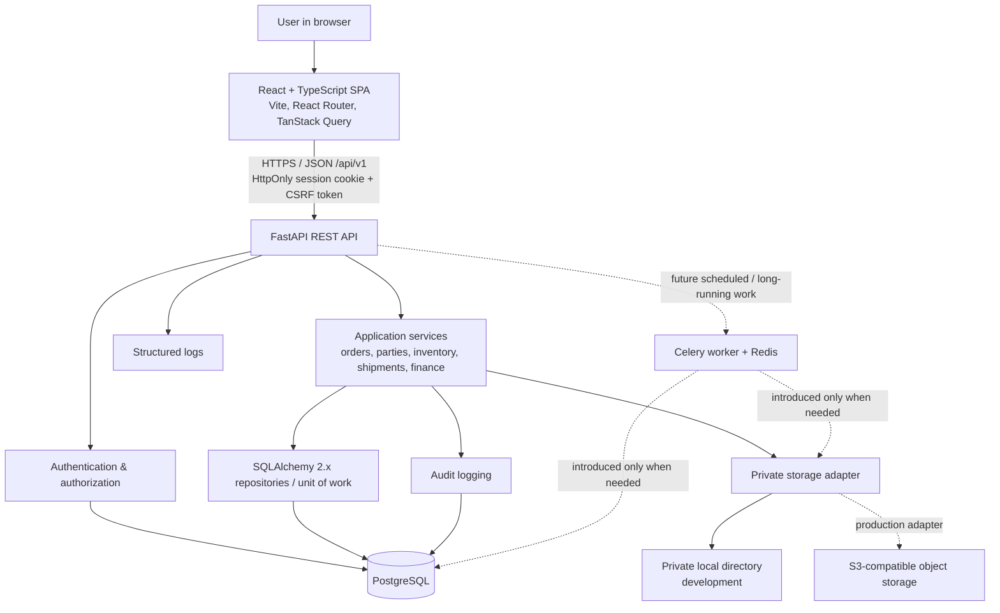
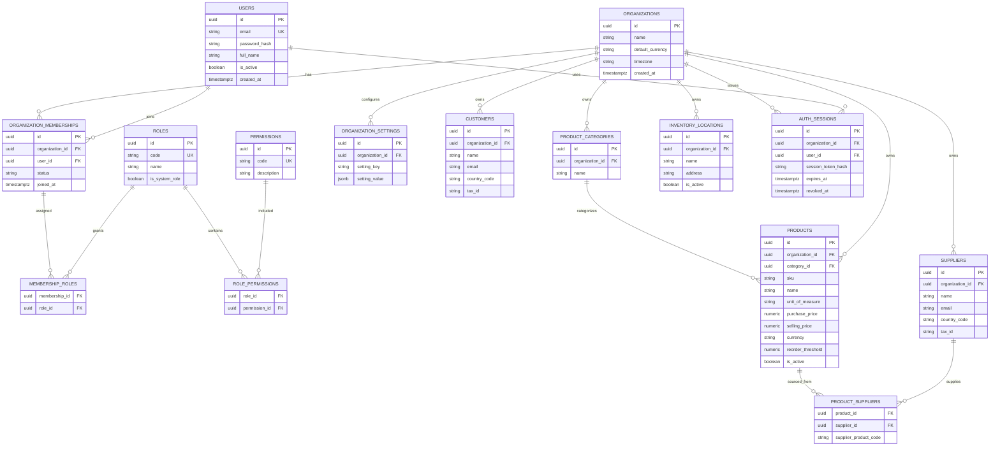
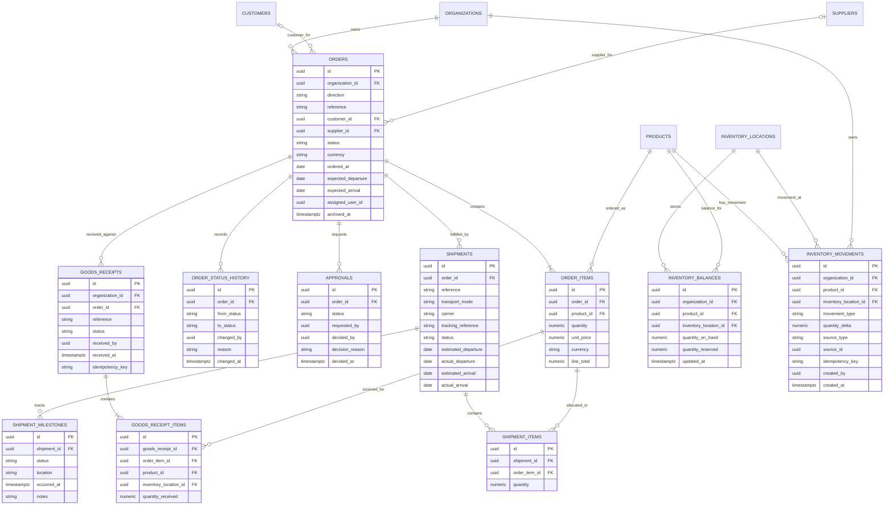
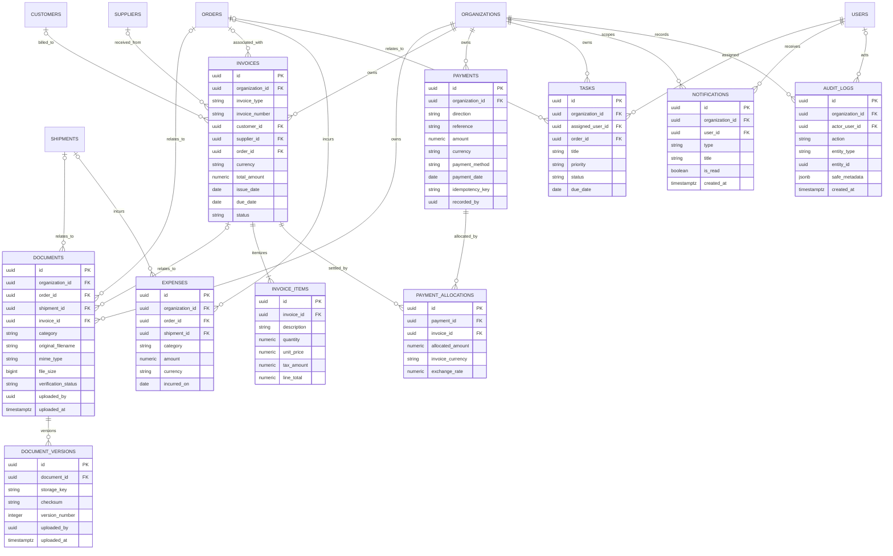
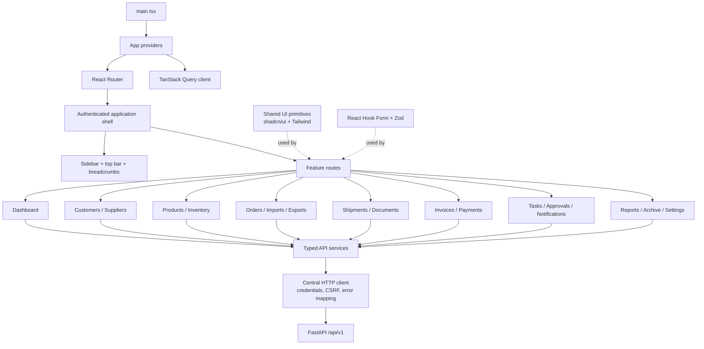
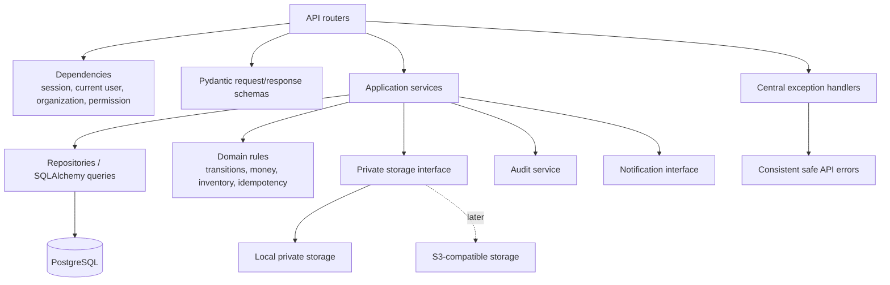

# Importer & Exporter Management System
## Phase 1 — Architecture and Planning

**Status:** Phase 1 architecture baseline prepared  
**Scope:** Architecture, data model, UI/backend module boundaries, API plan, authorization matrix, workflows, and delivery milestones.  
**Not included yet:** Phase 2 code scaffolding, migrations, authentication implementation, or runtime verification.

---

## 1. Executive summary

Build a **modular monolith** with a React + TypeScript SPA, a versioned FastAPI REST API, and PostgreSQL as the source of truth. Keep business rules in backend services, keep financial and inventory changes transactional, and enforce organization scoping and permissions on every protected backend operation.

Initial deployment will use Docker Compose for local development. Private documents will go through a storage adapter: private local storage during development and S3-compatible object storage in production. Add Redis/Celery only when scheduled reminders or longer-running background work is introduced; they are not required for the first foundation.

### Architecture principles

1. **Backend is authoritative:** permissions, status transitions, financial math, stock movements, and receipt/payment posting are enforced by the backend.
2. **Organization isolation by default:** every tenant-owned record is scoped to an organization, and organization membership is checked on every request.
3. **Ledger over silent mutation:** stock and financial history is recorded as movements/allocations/adjustments; consequential records are not silently overwritten.
4. **Transactions for business operations:** a receipt, dispatch, or payment allocation commits all related writes together or none of them.
5. **One codebase, clear module boundaries:** start as a modular monolith instead of splitting into microservices.
6. **Real data only:** dashboard totals and reports query persisted business records; any seed data is explicitly development-only.
7. **Build incrementally:** finish and verify each phase before adding the next feature group.

---

## 2. System architecture



### Request path

1. The user interacts with the React application.
2. A feature calls a typed API function; TanStack Query manages server state, caching, and invalidation.
3. The browser sends the session cookie and the CSRF token on state-changing requests.
4. FastAPI resolves the user, active organization membership, and required permission.
5. A route validates the HTTP request with Pydantic and calls a service function.
6. The service applies business rules and uses a SQLAlchemy transaction for related writes.
7. PostgreSQL commits the change; only then does the API return success.
8. Consequential actions create audit records in the same transaction where practical.

### Deployment shape

- **Frontend:** static Vite build served by a web server or reverse proxy.
- **Backend:** one FastAPI application process/service, with multiple workers only after deployment settings are validated.
- **Database:** PostgreSQL with Alembic-managed schema changes.
- **Files:** private storage outside the public frontend directory.
- **Background processing:** deferred until a real scheduled or long-running requirement exists.
- **Configuration:** environment variables; `.env.example` contains placeholders only.

---

## 3. Architecture decisions

| Decision | Baseline | Why / constraints |
|---|---|---|
| Application topology | Modular monolith | Keeps deployment and local development simple while retaining clear boundaries. |
| API | FastAPI REST under `/api/v1` | Versioned, typed request/response contracts and OpenAPI docs. |
| Persistence | PostgreSQL + SQLAlchemy 2.x + Alembic | Relational integrity, transactions, indexes, and reviewable migrations. |
| Frontend server state | TanStack Query | Avoids duplicating API state in broad global stores. |
| Forms | React Hook Form + Zod | Reusable client validation; backend validation remains authoritative. |
| Authentication | Opaque server-side session in an `auth_sessions` table; password hashes using Argon2id | Supports revocation and avoids storing bearer tokens in browser local storage. |
| Browser session transport | `HttpOnly`, `Secure` in production, `SameSite=Lax` cookie; CSRF token on unsafe methods | Reduces token exposure and addresses cross-site request forgery risks for cookie-authenticated APIs. Configure exact allowed frontend origins and credentialed CORS in development. |
| Authorization | Organization membership + permission records + role assignments | Supports multiple organizations per user and least-privilege access. Never rely on hidden UI controls alone. |
| Tenant isolation | Organization ID on tenant-owned records; shared dependency/service checks on every operation | Prevents cross-organization data leakage and IDOR vulnerabilities. Consider PostgreSQL row-level security later as defense in depth, not as a substitute for application checks. |
| Inventory | Append-only movement ledger plus transactionally maintained balances | Prevents silent stock changes and supports reconciliation/history. |
| Financials | `Decimal`/PostgreSQL `NUMERIC`, explicit ISO currency codes and payment allocations | Avoids binary floating-point errors and supports partial payments. |
| Documents | Storage adapter + private object keys + authenticated download endpoint | No public document URLs or frontend-bundled uploads. |
| Background work | Deferred; add Celery/Redis when scheduled or long-running work is implemented | Avoids infrastructure that is not yet needed. Must become retry-safe and duplicate-safe when added. |
| IDs and timestamps | UUID primary keys; UTC timestamps stored as timezone-aware values | Safe references across modules and consistent time handling. UI applies organization/user timezone settings. |
| Delete/archive | Archive or soft-delete eligible business records; preserve accounting and movement history | Historical records must not disappear due to routine cleanup. Permanent deletion is a separate, authorized process. |

### Baseline data conventions

- IDs: UUID primary keys.
- Time: timezone-aware UTC timestamps; API serializes as ISO 8601.
- Amounts: PostgreSQL `NUMERIC(19,4)` and Python `Decimal` unless a specific instrument needs different precision; document rounding per calculation.
- Exchange rates: explicit numeric precision (for example `NUMERIC(20,10)`), rate source/date, and stored historical rate when conversion is supported.
- Currency: three-character currency code; never total unlike currencies without an explicit reporting currency and conversion rule.
- Quantities: `NUMERIC(18,4)` baseline to support fractional units where the unit of measure allows them; validate precision per product/unit.
- Statuses: named enums/constants, validated transition functions, and status-history rows for important workflows.
- Audit: actor, organization, timestamp, action, entity type/ID, and safe metadata; do not log passwords, session tokens, or secrets.

---

## 4. Database ER diagrams

The following ERDs are the **logical Phase 1 model**. Physical column details and indexes will be finalized in SQLAlchemy models and Alembic migrations during Phase 2. Every tenant-owned table should include `organization_id` directly or be reachable only through a parent that is scoped and checked; direct `organization_id` is preferred for high-use business records and auditability.

### 4.1 Identity, roles, parties, and catalog



**Relationship notes:** users can belong to multiple organizations; a user receives roles through an organization membership, not through a global user role. Role definitions and permission codes are seeded by migrations. Customer and supplier duplicate checks should use normalized values and country/tax identifiers where available, but should not reject legitimate records solely because names match.

### 4.2 Orders, shipments, receipts, and stock ledger



**Required constraints and rules:**

- Unique order reference per organization (and direction if reference sequences are separate).
- An import order requires a supplier; an export order requires a customer. Enforce this in service validation and, where practical, database constraints.
- An order can have multiple shipments; `shipment_items` supports partial shipments.
- A goods receipt can receive only the outstanding quantity, unless an authorized exception is approved.
- Receipt confirmation, movement-ledger insert, and balance update happen in one transaction. A unique idempotency/source key prevents the same receipt from posting twice.
- Recommended default export stock policy: reserve stock when the export order is confirmed; decrement on-hand stock when dispatch is recorded; release any unshipped reservation on cancellation. A configurable policy can be added later. Never reserve or deduct stock merely because a draft order was created.
- Use row locks or guarded conditional updates when changing balances to prevent two concurrent operations from overselling available stock.
- Live carrier tracking is not part of the initial model; milestones are manual until a real provider integration is implemented.

### 4.3 Documents, finance, tasks, notifications, and audit



**Financial and document integrity rules:**

- Invoice total, paid amount, and outstanding balance are calculated from persisted invoice items and payment allocations, not trusted from client-submitted totals.
- Payment records are allocated to one or more invoices; allocations are checked against invoice currency and outstanding balance. Cross-currency allocation requires an explicitly stored rate/date and documented rounding.
- Never silently edit a posted payment to correct it. Use a reversal or adjustment record and retain the original audit trail.
- Use a unique organization-scoped payment idempotency key or external payment reference where appropriate to prevent duplicate postings.
- A document must be linked to an authorized organization-owned record. Add a database check requiring one valid parent association (order, shipment, or invoice) unless a separately approved standalone-document use case is added.
- Store a random/private storage key, not a user-controlled path. Validate file size and permitted content type, verify authorization on every download, and do not expose public object URLs.
- `AUDIT_LOGS.entity_type/entity_id` is intentionally polymorphic for cross-module audit history; its writer must validate entity ownership before writing.
- Archiving uses archive metadata on eligible business records and does not copy/delete invoices, payment allocations, or inventory movements.

---

## 5. Frontend architecture

Use feature-based folders, typed service functions, and shared design primitives. A feature owns its pages, API functions, types, and feature-specific components. Shared UI must not contain business-specific API logic.



### Suggested frontend folder layout

```text
frontend/
  src/
    app/
      providers.tsx
      query-client.ts
    components/
      layout/                 # AppShell, Sidebar, Header, Breadcrumbs
      shared/                 # DataTable, Search, Filters, EmptyState, ErrorState
      ui/                     # shadcn/ui primitives
    features/
      auth/
      dashboard/
      customers/
      suppliers/
      products/
      inventory/
      orders/
      imports/
      exports/
      shipments/
      documents/
      invoices/
      payments/
      tasks/
      approvals/
      notifications/
      reports/
      archive/
      settings/
    hooks/
    lib/                      # env, formatting, currency/date helpers
    routes/                   # route definitions and guards
    services/                 # central typed HTTP client
    types/                    # shared API primitives only
    App.tsx
    main.tsx
```

### Frontend implementation rules

- TypeScript `strict: true`; avoid `any`.
- Use `TanStack Query` for API state; only place truly client-owned state in local/component state or a small app store if later justified.
- Use `React Hook Form` + `Zod` for forms. Mirror core validations in Pydantic; client validation is for user experience, not security.
- Centralize API base URL, cookie credentials, CSRF header behavior, and API error parsing in one HTTP client.
- Use explicit states for loading, empty, success, and failure. Tables need server-side pagination/filtering for growing datasets.
- Format money and dates using organization preferences, but preserve ISO values and currency codes in the API contract.
- Route guards improve navigation UX only; every endpoint independently checks authorization.
- Destructive/consequential actions require confirmation and a clear explanation. Avoid inert buttons; disable unavailable actions with an explanation or omit them.
- Use accessible labels, keyboard navigation, focus management, and responsive layouts.

---

## 6. Backend module architecture



### Suggested backend folder layout

```text
backend/
  app/
    api/
      routes/                 # endpoint definitions, grouped by feature
      dependencies/           # DB session, auth, active org, permissions
    core/
      config.py               # Pydantic settings / environment validation
      security.py             # password hash, session, CSRF helpers
      permissions.py          # permission codes and checks
      logging.py              # structured, redacted logging
      errors.py               # domain/API exception mapping
    db/
      base.py
      session.py
    models/                   # SQLAlchemy table models only
    schemas/                  # Pydantic API contracts
    repositories/             # database query and persistence patterns
    services/                 # domain operations / transaction boundaries
    storage/                  # storage interface + local implementation
    tasks/                    # deferred background tasks
    utils/
    main.py
  alembic/
  tests/
    unit/
    integration/
    security/
  requirements.txt            # exact pins / lock strategy documented
  alembic.ini
```

### Backend service boundaries

| Service | Owns | Must not do |
|---|---|---|
| `auth_service` | Login/logout, session creation/revocation, account checks | Return password hashes or log session secrets. |
| `organization_service` | Membership, organization settings, invitations | Assume organization IDs supplied by the client are authorized. |
| `customer_service` / `supplier_service` | Party validation and CRUD | Access another organization’s records. |
| `product_service` | Product/catalog validation and supplier associations | Directly change stock balances without a ledger movement. |
| `inventory_service` | Balance locks, ledger movements, reservation/receipt/dispatch posting | Accept client-provided balances as truth or silently overwrite history. |
| `order_service` | Import/export creation, item totals, status transitions, order timelines | Treat a draft as stock received or shipped. |
| `shipment_service` | Shipment allocation, milestones, partial shipment quantities | Claim carrier events are live without a provider integration. |
| `document_service` | Upload validation, private storage key, versions, verification | Expose storage keys or skip parent-record authorization. |
| `invoice_service` | Invoice totals, due dates, balance calculations | Use floating-point math or trust submitted totals. |
| `payment_service` | Payment posting, allocations, idempotency, reversals | Silently mutate posted payments or double-allocate funds. |
| `approval_service` | Request/decision rules and approval history | Let a user approve an action they submitted when separation of duties is required. |
| `report_service` | Permission-scoped, currency-aware queries and CSV export | Combine currencies without a reporting-currency conversion rule. |
| `audit_service` | Durable audit events with redacted metadata | Store passwords, tokens, or unnecessary sensitive values. |

### Transaction boundary rule

Business services should own transaction boundaries for multi-record operations. A route should not manually coordinate multiple independent commits. For example, confirming a goods receipt should validate the receipt, lock/check the relevant balance, insert movement rows, update balance rows, mark the receipt posted, and record audit data in one transaction. A uniqueness constraint or idempotency key must make safe retries possible.

---

## 7. API endpoint plan

All routes are under `/api/v1`. Exact response fields will be documented through Pydantic schemas in Phase 2. This plan is a resource boundary, not a claim that endpoints already exist.

### 7.1 Conventions

- JSON for normal requests/responses; `multipart/form-data` for uploads.
- UUIDs in paths; dates in ISO 8601; timestamps include timezone.
- List endpoints support `page`, `page_size` (default 25, maximum 100), `sort_by`, `sort_order`, and documented filters where relevant.
- Standard list response: `items`, `page`, `page_size`, `total`.
- Standard error response: `code`, `message`, optional field-level `details`, and `request_id`. No stack traces, SQL messages, or secrets in client errors.
- Return `201 Created` for creation, `204 No Content` for successful no-body deletion/revocation where appropriate, `401` for unauthenticated, `403` for unauthorized, `404` when the record is not visible in the active organization, `409` for state/idempotency conflicts, and `422` for validation errors.
- Avoid permanent-delete endpoints for financial and inventory history. Prefer archive/deactivate/reversal operations.

### 7.2 Authentication and organizations

| Method | Endpoint | Purpose | Permission / control |
|---|---|---|---|
| `POST` | `/auth/login` | Verify credentials and issue a session cookie | Rate-limit; generic invalid-credential response. |
| `POST` | `/auth/logout` | Revoke current session | Authenticated session. |
| `GET` | `/auth/me` | Current user and active organization context | Authenticated. |
| `GET` | `/auth/csrf` | Obtain CSRF token for the current session | Session-aware. |
| `POST` | `/auth/password-reset/request` | Request recovery without account enumeration | Rate-limit; generic response. |
| `POST` | `/auth/password-reset/confirm` | Complete reset using a short-lived, single-use token | Token validation and session revocation policy. |
| `GET` | `/organizations` | Organizations available to current user | Membership-scoped. |
| `POST` | `/organizations` | Create organization and initial owner membership | Authenticated; server assigns owner. |
| `GET` | `/organizations/{org_id}` | Organization profile | Membership and `settings.view`. |
| `PATCH` | `/organizations/{org_id}` | Update organization profile | `settings.manage`. |
| `GET` | `/organizations/{org_id}/members` | List members | `users.view`. |
| `POST` | `/organizations/{org_id}/invitations` | Invite a user | `users.manage`; invitation token expires and is single-use. |
| `PATCH` | `/organizations/{org_id}/members/{membership_id}` | Change membership status/roles | `users.manage`; cannot remove final owner. |

### 7.3 Dashboard, master data, and inventory

| Method | Endpoint | Purpose | Permission / control |
|---|---|---|---|
| `GET` | `/dashboard/summary` | Real KPIs for active orders, transit shipments, overdue invoices, stock alerts | `dashboard.view`; values scoped to organization and user permissions. |
| `GET` | `/dashboard/trends` | Imports/exports and status trends by date range | `dashboard.view`; no cross-currency aggregation without conversion. |
| `GET, POST` | `/customers` | List/create customers | `customers.view` / `customers.create`. |
| `GET, PATCH` | `/customers/{id}` | Customer detail/update | `customers.view` / `customers.edit`. |
| `GET, POST` | `/suppliers` | List/create suppliers | `suppliers.view` / `suppliers.create`. |
| `GET, PATCH` | `/suppliers/{id}` | Supplier detail/update | `suppliers.view` / `suppliers.edit`. |
| `GET, POST` | `/product-categories` | List/create product categories | `products.view` / `products.manage`. |
| `GET, POST` | `/products` | List/create products | `products.view` / `products.create`. |
| `GET, PATCH` | `/products/{id}` | Product detail/update/deactivate | `products.view` / `products.edit`. |
| `GET, POST` | `/inventory/locations` | List/create storage locations | `inventory.view` / `inventory.manage`. |
| `GET` | `/inventory/balances` | On-hand, reserved, and available quantities | `inventory.view`. |
| `GET` | `/inventory/movements` | Search/filter inventory ledger | `inventory.view`. |
| `POST` | `/inventory/adjustments` | Record authorized stock adjustment with reason | `inventory.adjust`; transactional ledger entry. |

### 7.4 Orders, imports, exports, shipments, documents

| Method | Endpoint | Purpose | Permission / control |
|---|---|---|---|
| `GET` | `/orders` | Central list with direction, status, party, date, assignee, and currency filters | `orders.view`; organization-scoped. |
| `GET` | `/orders/{id}` | Shared order details and related records | `orders.view`. |
| `GET` | `/orders/{id}/timeline` | Status and activity timeline | `orders.view`. |
| `POST` | `/imports` | Create import draft with line items | `imports.create`. |
| `GET, PATCH` | `/imports/{id}` | Read/update import draft or allowed fields | `imports.view` / `imports.edit`; status-transition checks. |
| `POST` | `/imports/{id}/submit` | Submit import for approval | `imports.submit`; cannot bypass approval policy. |
| `POST` | `/exports` | Create export draft/quotation with line items | `exports.create`. |
| `GET, PATCH` | `/exports/{id}` | Read/update export draft or allowed fields | `exports.view` / `exports.edit`. |
| `POST` | `/exports/{id}/submit` | Submit export for approval | `exports.submit`. |
| `POST` | `/orders/{id}/cancel` | Cancel under permitted status and policy | `orders.cancel`; reason required; release reservations where applicable. |
| `GET, POST` | `/orders/{id}/approvals` | View/request approval | `approvals.view` / `approvals.request`. |
| `POST` | `/approvals/{id}/approve` | Approve a pending request | `approvals.approve`; enforce separation of duties. |
| `POST` | `/approvals/{id}/reject` | Reject/return with reason | `approvals.approve`; reason required. |
| `GET, POST` | `/orders/{id}/shipments` | List/create shipments for an order | `shipments.view` / `shipments.create`. |
| `GET, PATCH` | `/shipments/{id}` | Read/update permitted shipment fields | `shipments.view` / `shipments.edit`. |
| `POST` | `/shipments/{id}/milestones` | Add manual milestone | `shipments.update_tracking`; event time and actor retained. |
| `POST` | `/shipments/{id}/dispatch` | Record dispatch, update reservation/on-hand according to policy | `shipments.dispatch`; idempotent and transactional. |
| `POST` | `/orders/{id}/goods-receipts` | Record a partial or complete receipt | `inventory.receive`; remaining quantity checked. |
| `POST` | `/goods-receipts/{id}/confirm` | Post confirmed receipt and stock movements | `inventory.receive`; duplicate-safe transaction. |
| `GET, POST` | `/documents` | List or upload document linked to an authorized parent | `documents.view` / `documents.upload`; private storage and size/type validation. |
| `GET, PATCH` | `/documents/{id}` | Metadata and verification state | `documents.view` / `documents.verify` for verification changes. |
| `GET` | `/documents/{id}/download` | Authorized streaming download | `documents.download`; never a public URL. |
| `POST` | `/documents/{id}/versions` | Add a new document version | `documents.upload`. |

### 7.5 Invoices, payments, operations, reporting, and archive

| Method | Endpoint | Purpose | Permission / control |
|---|---|---|---|
| `GET, POST` | `/invoices` | List/create supplier or customer invoices | `invoices.view` / `invoices.create`; computed totals. |
| `GET, PATCH` | `/invoices/{id}` | Detail and permitted pre-posting edits | `invoices.view` / `invoices.edit`; posted financial history protected. |
| `POST` | `/invoices/{id}/post` | Post/finalize an invoice | `invoices.post`; idempotent state transition. |
| `GET, POST` | `/payments` | List/create payment records | `payments.view` / `payments.record`; idempotency checks. |
| `POST` | `/payments/{id}/allocations` | Allocate payment amount to invoice(s) | `payments.allocate`; currency and balance checks. |
| `POST` | `/payments/{id}/reverse` | Reverse incorrect posted payment with reason | `payments.reverse`; original retained. |
| `GET, POST` | `/tasks` | List/create tasks | `tasks.view` / `tasks.create`. |
| `GET, PATCH` | `/tasks/{id}` | Update task/complete task | `tasks.view` / `tasks.edit`; history retained. |
| `GET` | `/notifications` | List current user's notifications | `notifications.view`. |
| `POST` | `/notifications/{id}/read` | Mark notification read | Owner user only. |
| `GET` | `/reports/{report_key}` | Run a named, permission-checked report | Relevant `reports.*` permission; supported filters documented. |
| `GET` | `/reports/{report_key}/export.csv` | Generate CSV export | `reports.export`; same row-level scope as report. |
| `GET` | `/archive` | Search eligible archived records | `archive.view`. |
| `POST` | `/archive/{entity_type}/{id}/restore` | Restore if permitted | `archive.restore`; eligibility checks and audit event. |
| `GET, PATCH` | `/settings` | Read/update organization settings | `settings.view` / `settings.manage`. |
| `GET` | `/audit-logs` | Search visible audit history | `audit.view`; sensitive metadata redacted. |
| `GET` | `/health/live` | Process liveness | No sensitive details. |
| `GET` | `/health/ready` | Database/config readiness | Minimal health response; protect infrastructure detail. |

**Note:** `GET, POST` or `GET, PATCH` in one table cell denotes separate endpoints for the same collection/resource path. Exact subresource paths will be normalized while implementing routers and OpenAPI schemas.

---

## 8. Authentication and permission matrix

### 8.1 Permission model

Permission codes should be stable and granular, such as `imports.view`, `imports.create`, `imports.edit`, `imports.submit`, `exports.approve`, `inventory.receive`, `payments.record`, `documents.download`, `users.manage`, `settings.manage`, `archive.restore`, and `reports.export`.

- A user's effective permissions come from roles assigned to their membership in the **active organization**.
- The backend must resolve the organization from an authorized session/context and validate access to the target record; a client-supplied `organization_id` is not proof of access.
- All list/detail/update/download/report endpoints must apply the same organization scope.
- Permission-denied and cross-organization records should not reveal the other organization’s content. Use a consistent `404` for records outside the active user's visible scope where this reduces record enumeration.
- Role assignments can be configured, but the initial defaults below are the starting point.
- Approval policy is separate from normal edit permission. By default, approvers cannot approve their own submitted request.

### 8.2 Initial role matrix

Legend: **R** = view/read, **C** = create, **E** = edit, **S** = submit, **A** = approve/reject, **M** = administer/manage, **X** = explicitly allowed action, **—** = not granted by default. Exact endpoint permissions remain granular; the table is a human-readable default policy.

| Capability | Owner | Administrator | Import Manager | Export Manager | Operations Staff | Finance Staff | Read-Only User |
|---|---|---|---|---|---|---|---|
| Organization profile/settings | M | M | R | R | R | R | R |
| Manage users, invitations, role assignments | M* | M | — | — | — | — | — |
| Customers | R/C/E | R/C/E | R/C/E | R/C/E | R | R | R |
| Suppliers | R/C/E | R/C/E | R/C/E | R | R | R | R |
| Products/categories | R/C/E | R/C/E | R | R | R | R | R |
| Inventory balances/history | R | R | R | R | R | R | R |
| Inventory receipt / stock adjustment | X | X | X (receipt only) | — | X (receipt only) | — | — |
| Import orders | R/C/E/S/A | R/C/E/S/A | R/C/E/S/A** | R | R/E (operational fields only) | R | R |
| Export orders | R/C/E/S/A | R/C/E/S/A | R | R/C/E/S/A** | R/E (operational fields only) | R | R |
| Shipment records/milestones | R/C/E | R/C/E | R/C/E (imports) | R/C/E (exports) | R/C/E | R | R |
| Document upload/download | X | X | X | X | X | X (finance documents) | R (download only where allowed) |
| Invoices | R/C/E/post | R/C/E/post | R (supplier invoices) | R (customer invoices) | R (limited) | R/C/E/post | R |
| Record/allocate/reverse payments | X | X | — | — | — | X | — |
| Tasks/notifications | R/C/E | R/C/E | R/C/E | R/C/E | R/C/E | R/C/E | R (own items) |
| Reports and CSV export | R/X | R/X | Ops reports | Ops reports | Assigned operational reports | Finance reports | R (no export by default) |
| Archive/restore | R/X | R/X | R (restore by policy) | R (restore by policy) | R | R | R |
| Audit log access | R | R | Relevant operational history | Relevant operational history | Relevant assigned/operational history | Financial history | Limited visible activity |
| Transfer ownership / delete organization | X | — | — | — | — | — | — |

`*` Owner can transfer ownership; Administrator cannot.  
`**` Import Manager can approve import requests and Export Manager can approve export requests **only when** they are not the submitting user and the configured approval policy grants that permission.  

**Least-privilege notes:**

- Split generic `X` into concrete permissions at implementation; it is not one broad permission code.
- Managers should not receive manual inventory-adjustment permission by default; receipt/dispatch movements are workflow actions, not arbitrary balance edits.
- Finance users may update invoice data before posting. Posted payments and invoices require controlled correction/reversal flows.
- Read-only users cannot change records or export reports by default. An organization owner may grant additional read/report-export capabilities where appropriate.
- UI actions may be hidden or disabled for usability, but API authorization is mandatory.

### 8.3 Session and security controls

- Hash passwords with Argon2id using a maintained library and safe parameters.
- Store only a hash of the opaque session token; revoke sessions on logout, password reset, membership deactivation, or account disablement according to policy.
- Use `HttpOnly` cookies and `Secure` in production; use a CSRF token for unsafe methods and verify `Origin`/`Referer` where appropriate.
- Configure CORS with explicit origins, not wildcard origins, when credentials are enabled.
- Rate-limit login and password-reset requests; use generic recovery responses to reduce account enumeration.
- Validate file uploads server-side and authorize all download routes.
- Redact authorization headers, cookies, reset tokens, passwords, and sensitive financial details from logs.
- Add audit entries for role changes, approval decisions, inventory movements/adjustments, document verification, invoice posting, payment posting/reversal, archival, and restoration.

---

## 9. Import workflow

```mermaid
flowchart TD
    A[Create import draft] --> B[Select/create supplier]
    B --> C[Add products, quantities, prices, currency, terms]
    C --> D[Enter estimated freight, insurance, duties and other costs]
    D --> E{Needs approval?}
    E -- Yes --> F[Submit for approval]
    F --> G{Decision}
    G -- Returned / rejected --> H[Correct draft or cancel]
    H --> C
    G -- Approved --> I[Confirm order]
    E -- No --> I
    I --> J[Create one or more shipments]
    J --> K[Add shipment milestones and documents]
    K --> L[Record goods receipt]
    L --> M{Receipt valid and within remaining quantity?}
    M -- No --> N[Return validation error; no stock changes]
    N --> L
    M -- Yes --> O[Confirm receipt in one database transaction]
    O --> P[Write inventory movement and update balance]
    P --> Q{All quantities received?}
    Q -- No --> L
    Q -- Yes --> R[Record supplier invoice(s) and allocate payments]
    R --> S[Reconcile estimated versus actual cost]
    S --> T{Order obligations complete?}
    T -- No --> U[Resolve missing documents, quantities, invoices or tasks]
    U --> S
    T -- Yes --> V[Complete and archive with history retained]
```

### Import invariants

- Creating or approving an import order does not increase inventory.
- Only a validated, confirmed goods receipt posts stock.
- Partial receipts are supported; each receipt can be retried safely without adding stock twice.
- Accepted quantities cannot exceed the outstanding order quantity unless a permitted exception is approved and audited.
- Freight, insurance, duties, and other charges remain separate estimated/actual cost records so users can reconcile them.
- Order completion checks configured required documents and business obligations; document requirements must be configurable by transaction type/jurisdiction rather than assuming every document is always required.

---

## 10. Export workflow

```mermaid
flowchart TD
    A[Create quotation / export draft] --> B[Select/create customer]
    B --> C[Add products, quantities, selling prices, currency and terms]
    C --> D[Validate stock availability and delivery details]
    D --> E{Needs approval?}
    E -- Yes --> F[Submit for approval]
    F --> G{Decision}
    G -- Returned / rejected --> H[Correct draft or cancel]
    H --> C
    G -- Approved --> I[Confirm export order]
    E -- No --> I
    I --> J[Reserve available stock according to policy]
    J --> K[Prepare one or more shipments and documents]
    K --> L[Validate shipment quantities against unshipped quantity]
    L --> M[Record dispatch]
    M --> N[Post stock movement and reduce on-hand quantity]
    N --> O[Track milestones and partial deliveries]
    O --> P[Create customer invoice(s)]
    P --> Q[Record and allocate full/partial payments]
    Q --> R{Delivered and financial/document obligations complete?}
    R -- No --> S[Continue delivery, documents, tasks or collections]
    S --> O
    R -- Yes --> T[Complete and archive with history retained]
```

### Export invariants

- Recommended default: reserve when an export order is confirmed; decrement on-hand stock on dispatch; release outstanding reservations on cancellation.
- Draft creation does not reserve or deduct stock.
- Reservation must use a transaction and guarded balance update so simultaneous confirmations cannot oversell available stock.
- Shipment item quantities cannot exceed the remaining allowed quantity unless an authorized exception is recorded.
- Partial shipments, deliveries, invoices, and payments are supported.
- A dispatch operation is idempotent; retrying the same operation cannot deduct stock twice.
- Payment allocations cannot cause the allocated total to exceed the payment amount or an invoice's outstanding balance, subject to explicitly defined credit/overpayment behavior.

---

## 11. Data validation and status model

### Proposed initial order statuses

`draft → submitted → approved → confirmed → in_progress → partially_completed → completed`

Additional controlled transitions: `submitted → returned_for_correction`, `submitted → rejected`, and eligible nonterminal statuses → `cancelled`. The service must define which transitions are legal per direction and role. Do not let clients send an arbitrary `status` value through a generic PATCH. Use explicit action endpoints such as submit, approve, confirm, dispatch, receive, complete, cancel, archive, and restore.

### Proposed invoice statuses

`draft → posted → partially_paid → paid`; `overdue` may be a derived condition based on due date and outstanding balance rather than a separate writeable status. Cancellation/reversal rules need an explicit policy and audit record.

### Proposed shipment statuses

`planned → ready → dispatched → in_transit → delivered`; controlled alternatives include `delayed`, `cancelled`, or `exception`. Milestones are appendable records; tracking integrations are a later feature.

### Validation ownership

| Validation | Frontend | Backend/database |
|---|---|---|
| Required fields, basic formats, friendly inline feedback | Yes | Revalidate on every write. |
| Organization ownership and permissions | UX only | Always enforce. |
| Status transition legality | Display allowed actions | Authoritative service check. |
| Money totals and outstanding balances | Preview only | Recompute using `Decimal` and persisted values. |
| Stock availability and remaining receipt/shipment quantities | Display current state | Lock/conditional update in transaction. |
| Duplicate reference/idempotency | Explain conflict | Unique constraints + conflict response. |
| File type/size/parent authorization | Client-side convenience only | Inspect and enforce server-side. |
| Currency conversion and rounding | Display chosen terms | Persist rate/date and apply documented precision. |

---

## 12. Reporting and dashboard data rules

- Dashboard cards and charts are database-backed aggregates and should link to the relevant filtered list.
- Dashboard API accepts a date range only where the metric has a meaningful date basis and returns the date basis used.
- Do not add EUR and USD as though they were the same currency. If multi-currency totals are needed, return separate currency buckets until the user selects a reporting currency and conversion rule.
- “Overdue” invoices are computed from due date and outstanding balance using the organization's configured timezone/date rules.
- “Delayed” shipments compare expected arrival with current/actual status; a shipment that has no expected date must not be silently classified as on time or late.
- CSV exports use the same organization and record permissions as interactive reports and are audited.
- Expensive reports can later move to background jobs; the initial reports should use indexed queries and bounded date ranges.

---

## 13. Development milestones and acceptance gates

| Phase | Scope | Exit / verification gate |
|---|---|---|
| **1 — Architecture and planning** | This document, system/data diagrams, module boundaries, API plan, permission defaults, workflows, assumptions | Review architecture and explicitly decide unresolved business policy before feature code depends on it. |
| **2 — Project foundation** | React + TS + Vite, FastAPI, settings, PostgreSQL, SQLAlchemy, Alembic, Compose, health endpoints, README | Frontend starts; backend starts; DB health is confirmed; migration runs from clean DB; readiness endpoint works; no secrets committed. |
| **3 — Authentication and organizations** | Sessions, login/logout/recovery, org setup, membership, seeded roles/permissions, protected routes | Auth/security tests, permission tests, and cross-organization isolation tests pass before dashboard/master data. |
| **4 — Application shell and dashboard** | Responsive layout, navigation, shared components, dashboard API and real metrics | Loading/error/empty behavior tested; cards navigate correctly; dashboard values are database-derived. |
| **5 — Master data** | Customers, suppliers, product catalog, locations, inventory ledger foundation | CRUD, validation, tenant isolation, and ledger/balance consistency tests pass. |
| **6 — Import management** | Import drafts/items, approval, shipments/documents, partial receipts, actual costs | Partial receipt, over-receipt rejection, and duplicate-safe inventory tests pass. |
| **7 — Export management** | Export draft/order, approval, reservations, partial dispatch/delivery, invoices/payment links | Concurrency, reservation release, quantity limits, and duplicate-dispatch tests pass. |
| **8 — Documents and shipments** | Private uploads, versions, verification, timelines, delay indicators | Unauthorized downloads blocked; invalid files rejected; no fake tracking integration. |
| **9 — Invoices and payments** | Supplier/customer invoices, posting, payment allocations, currencies, corrections | Decimal/rounding, partial-payment, over-allocation, duplicate-posting, and audit tests pass. |
| **10 — Tasks and automation** | Tasks, approvals, notifications, scheduled reminders, retry/idempotency controls | Repeated scheduler runs do not duplicate reminders; automation events are logged. Add Celery/Redis if genuinely needed. |
| **11 — Reports and archive** | CSV reports, historical queries, archive/restore, permissions | Currency rules, report access, archive history, and restoration permissions tested. |
| **12 — Final hardening** | Type checks, builds, tests, migrations, E2E, security/accessibility, deployment notes | Run and record actual results; document every remaining limitation. |

### Minimum automated test layers

- **Unit:** status transition rules, Decimal calculations, permission resolution, validation helpers.
- **Integration:** SQLAlchemy/PostgreSQL transactions, unique/idempotency constraints, partial receipts, stock concurrency, invoice allocations.
- **API security:** unauthenticated access, forbidden actions, cross-organization IDs, private document downloads, report scope.
- **Frontend:** forms, validation display, loading/empty/error states, route behavior, permission-aware controls.
- **End-to-end:** login → import → approval → receipt → stock update; export → reserve/dispatch → invoice → partial payment; document verification; archive/restore; tenant isolation.

No phase should be declared complete based only on a visually correct UI or on tests that were not actually executed.

---

## 14. Assumptions and decisions to confirm before the affected feature is built

The project can proceed with these default assumptions; change them before the related phase if the business rules differ.

1. **Multi-organization:** a user may be a member of more than one organization, with roles assigned separately in each organization.
2. **Import/export order model:** a shared `orders` table with `direction = import | export` and specialized service/API routes. This keeps shared timeline, shipment, audit, and archive behavior consistent.
3. **Shipment relationship:** a shipment belongs to one order initially; an order can have many shipments. Multi-order consolidated shipments can be added later if real operations need them.
4. **Inventory policy:** imports increase stock only on confirmed receipt. Exports reserve on order confirmation and reduce on-hand stock at dispatch; cancellation releases unshipped reservations.
5. **Approval default:** submitter cannot approve their own request. Import/export managers are the default approvers for their respective order type only when granted the approval permission; owner/admin can approve according to policy.
6. **Currency:** every order, invoice, expense, and payment stores an explicit currency. Cross-currency accounting requires stored rates and a business-approved rounding policy; no silent conversion.
7. **Document requirements:** required documents are configurable by transaction/process; there is no universal hardcoded requirement list for every shipment.
8. **Tracking:** milestones are manually entered until a documented carrier API is implemented.
9. **Storage:** local private storage is for development only; production uses private S3-compatible storage and controlled downloads.
10. **Authentication:** server-side sessions are the baseline for the first implementation. If deployment architecture requires stateless token authentication, revisit this before Phase 3, not after it is wired through the frontend.
11. **Tax/legal rules:** tax identifiers, duties, document retention, data protection, and invoice requirements vary by jurisdiction. The system should store configurable fields and avoid claiming legal/tax compliance until the applicable country rules are specified and reviewed.
12. **Accounting scope:** the application tracks invoices and payments; it is not assumed to be a full general ledger/accounting package.

### Business rules that need a decision before production use

- Which users/roles can approve each order type and at what amount thresholds?
- Are stock quantities allowed to go negative for any product or location? Default: **no**.
- How should overpayments, credit notes, refunds, and payment reversals work? Must be designed before Phase 9.
- Which currency conversion source, date, and rounding rules should be used for consolidated reports?
- Which document requirements apply by country, transport mode, product, and transaction type?
- What retention and deletion policy applies to documents, audit records, and personal/business data?
- Is a single shipment ever allowed to contain goods from multiple orders? Initial design: **no**.

---

## 15. Phase 1 completion checklist

- [x] System architecture diagram
- [x] Database ER diagrams for identity/master data, orders/inventory, and documents/finance/operations
- [x] Frontend component architecture and suggested folder layout
- [x] Backend module architecture and service boundaries
- [x] Versioned REST API endpoint plan
- [x] Authentication and role/permission baseline
- [x] Import workflow diagram and invariants
- [x] Export workflow diagram and invariants
- [x] Development milestones and acceptance gates
- [x] Major assumptions and decisions to confirm
- [ ] Review/approval of business-policy assumptions
- [ ] Phase 2 implementation and runtime verification

**Next step:** start Phase 2 only after this architecture baseline is accepted or the listed assumptions are adjusted. Phase 2 should create the real frontend/backend foundation, PostgreSQL connection, first Alembic migration, Docker Compose setup, health endpoints, environment template, and setup README—then run and record the startup/migration checks.
