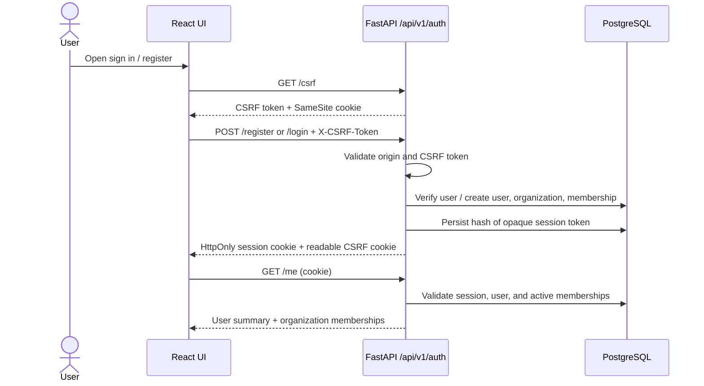
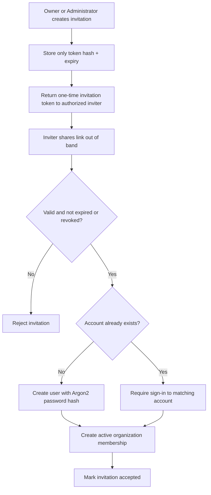

# Phase 3 — Authentication and Organizations

## Scope delivered

Phase 3 extends the existing Phase 1 architecture and Phase 2 runtime foundation. It adds a first authentication workflow, multi-organization membership, organization-scoped access, role checks, one-time invitations, frontend protected routes, and an initial test suite. It intentionally does not implement import/export operations or financial/inventory modules.

## Authentication flow

### Session and password handling

- Passwords are hashed with Argon2 (`argon2-cffi`). Plaintext passwords are never stored or logged.
- Session cookies hold random opaque bearer tokens. The database stores only SHA-256 token hashes; sessions can expire or be revoked.
- The session cookie is `HttpOnly`, `SameSite=Lax`, scoped to `/`, and `Secure` is mandatory when `APP_ENV=production`.
- Unsafe browser requests use a double-submit CSRF token. For authenticated write requests, the CSRF value is also checked against the current session's stored hash.
- Browser-origin checks reject an explicit origin not listed in `CORS_ORIGINS`.
- Login gives a generic response for an unknown email and a wrong password.
- Session expiry is absolute and controlled by `SESSION_TTL_HOURS`.

## Organization and role model

An account can belong to multiple organizations. The `organization_memberships` table is the source of truth for a user's role and membership status in each organization. Every organization-scoped route checks membership for the organization ID supplied in the route before returning or changing organization data.

On public registration, a new user and organization are created in one database transaction and the user receives the `organization_owner` role. Users can create additional organizations while signed in; the creator becomes the owner of that organization.

### Current role and permission matrix

| Role | Read members | Invite members | Change members | Business permissions planned for later modules |
|---|---:|---:|---:|---|
| Organization Owner | Yes | Yes | Yes, except owner membership | Organization administration; full business permissions |
| Administrator | Yes | Yes, excluding Administrator invitations and owner changes | Yes, except administrators and owner membership | Organization administration; business administration |
| Import Manager | No | No | No | Imports, import submission, customer/supplier/product/inventory reads, documents and shipments |
| Export Manager | No | No | No | Exports, export submission, customer/product/inventory reads, documents and shipments |
| Operations Staff | No | No | No | Shipment updates, document upload, inventory receiving/dispatch, tasks |
| Finance Staff | No | No | No | Invoice/payment management, finance reports, document reads |
| Read-Only User | No | No | No | Read-only access to configured business records |

The backend permission mapping lives in `backend/app/core/permissions.py`. Permissions for business modules are declared for reuse by later phases; those business endpoints are not implemented yet. Hiding a frontend control is not treated as authorization.

Owner memberships are protected from changes through the member-management API. An administrator cannot grant administrator privileges or modify another administrator. A member cannot deactivate their own membership.

## Invitation lifecycle

An invitation token is random, stored only as a hash, expires after `INVITATION_TTL_HOURS`, and is single-use. Revoking an invitation marks it revoked; it does not delete audit-relevant history. The browser invitation URL places the token in the URL fragment (`#token=...`) so it is not part of the HTTP request sent to the web server. The preview API sends it in a POST body rather than a request URL to avoid routine access-log leakage. Email delivery is **not configured** in this phase. The authorized inviter receives the token once and must share the link securely through an approved channel. Do not log or paste invitation links into shared logs or tickets.

## Database tables added in Alembic revision `0002_auth_organizations`

- `users`: normalized unique email, display name, Argon2 password hash, account-active flag, timestamps.
- `organizations`: name, unique slug, timestamps.
- `organization_memberships`: user/organization relation, role check constraint, active flag, timestamps, unique `(organization_id, user_id)`.
- `user_sessions`: hashed session token, hashed CSRF token, expiration/revocation, user-agent metadata.
- `organization_invitations`: hashed single-use token, invited email/role, inviter, expiry, accepted/revoked timestamps.

IDs use UUIDs. PostgreSQL is the intended database; SQLite is used by automated tests to keep tests isolated. Changes must go through Alembic migrations.

## API plan implemented

| Method | Endpoint | Purpose |
|---|---|---|
| GET | `/api/v1/auth/csrf` | Issue/rotate CSRF token |
| POST | `/api/v1/auth/register` | Create owner account and organization (if enabled) |
| POST | `/api/v1/auth/login` | Verify credentials and establish session |
| POST | `/api/v1/auth/logout` | Revoke the current session |
| GET | `/api/v1/auth/me` | Return signed-in user and active organizations |
| POST | `/api/v1/auth/invitations/preview` | Preview a valid invitation (token sent in body) |
| POST | `/api/v1/auth/accept-invitation` | Accept invitation; create an account where needed |
| GET | `/api/v1/organizations` | List organizations the current user belongs to |
| POST | `/api/v1/organizations` | Create organization; creator becomes owner |
| GET | `/api/v1/organizations/{id}/members` | List members if authorized |
| PATCH | `/api/v1/organizations/{id}/members/{membership_id}` | Change an allowed member role/status |
| POST | `/api/v1/organizations/{id}/invitations` | Create one-time invitation |
| DELETE | `/api/v1/organizations/{id}/invitations/{invitation_id}` | Revoke pending invitation |

FastAPI OpenAPI docs expose request and response contracts in development at `/docs`.

## Frontend routes

- `/`: public landing page with sign-in or registration actions.
- `/login`: credential form with client validation and server error handling.
- `/register`: user and initial organization registration.
- `/accept-invitation#token=...`: invitation review and acceptance; the token is stored in the URL fragment rather than sent in the initial HTTP request.
- `/app`: protected workspace with organization selection, member access, role changes, and invitations.

API requests use `credentials: include`; session tokens are not stored in local storage. An unauthorized response clears the frontend's current authenticated state.

## Explicit limitations and production readiness

- No email provider is wired in: invitation links must be shared out of band. Password recovery and email verification are not implemented.
- No application-level distributed rate limiter is included. Before production exposure, enforce rate limits for registration, login, and invitation endpoints at a trusted gateway or add a shared rate-limit store.
- Review `ALLOW_SELF_REGISTRATION` before deployment. Set it to `false` for invite-only operation and bootstrap the first owner with the CLI described in the README.
- Set `APP_ENV=production`, `SESSION_COOKIE_SECURE=true`, a production-only CORS allowlist, TLS, proper secret handling, monitoring, backups, and restore tests.
- Add session/session-record retention cleanup and security monitoring before production.
- Role permissions for future business modules are mapped but cannot authorize endpoints that have not been built yet.
- The frontend production build could not be validated in this environment because npm registry package retrieval failed. Run the documented frontend typecheck, tests, and build in an environment with npm registry access.
