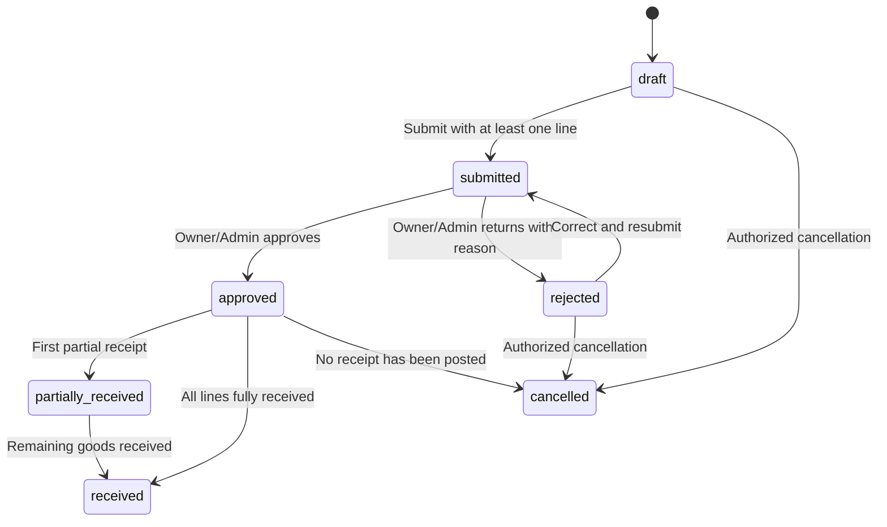

# Phase 6 — Import Management

Phase 6 adds an organization-scoped import workflow to the Phase 1–5 application. It builds on Phase 5 suppliers, products, inventory locations, balances, and stock movement ledger.

## Scope delivered

- Create and search draft import orders; filter by status, supplier, reference, and date; view order details and status history.
- Add, update, and remove order lines while an order is draft or returned for correction. Product and supplier selections must be active and belong to the same organization.
- Submit an order for approval; allow an Organization Owner or Administrator to approve or reject it; cancel only permitted orders and preserve status history.
- Store estimated and actual logistics costs with explicit currency and `Decimal` / PostgreSQL `NUMERIC` arithmetic.
- Add shipment records and manual milestones; track carrier/tracking reference, mode, planned/actual dates, status, and delay reason. The order's actual departure is derived from the earliest shipment departure date, and actual arrival from the latest recorded arrival date.
- Record partial and final goods receipts. A receipt posts its header, receipt lines, ordered-line received quantities, inventory balance, and inventory movement ledger entries within one database transaction.
- Protect retryable receipt writes with organization-scoped idempotency keys and request hashes. An identical replay returns the existing receipt and does not add stock again. Reusing a key for a different payload is rejected. Receipts cannot exceed remaining ordered quantities.
- Upload, list, authorized-download, verify/reject, and delete import-order documents. Files are stored outside the public frontend tree, use generated storage keys, are size-limited, and undergo basic extension/content-signature checks.
- Dashboard aggregates include active import orders, submitted orders awaiting approval, partially received orders, fully received orders, and manually delayed import shipments.

## Import order lifecycle

The API enforces allowed transitions. Orders with any posted receipt cannot be cancelled. If goods or financial records need correction after posting, the correction must be represented as a separate auditable operation rather than deleting the existing receipt or stock history.

## API overview

All routes below are under `/api/v1`. Every record request requires an active session and an authorized `organization_id`; mutation requests require CSRF protection.

| Method | Route | Use |
|---|---|---|
| GET / POST | `/imports` | Search/paginate orders; create a draft order with optional initial lines |
| GET / PATCH | `/imports/{order_id}` | Read/update planning details |
| POST | `/imports/{order_id}/items` | Add a line |
| PATCH / DELETE | `/imports/{order_id}/items/{item_id}` | Update/remove a line while editable |
| POST | `/imports/{order_id}/submit` | Submit for approval; requires a line |
| POST | `/imports/{order_id}/approve` | Approve a submitted order; owner/admin permission |
| POST | `/imports/{order_id}/reject` | Return a submitted order with reason; owner/admin permission |
| POST | `/imports/{order_id}/cancel` | Cancel an eligible order |
| PATCH | `/imports/{order_id}/costs` | Record actual freight/insurance/duties/other cost fields |
| GET / POST | `/imports/{order_id}/shipments` | List/add shipments |
| PATCH | `/imports/shipments/{shipment_id}` | Update shipment status and dates |
| GET / POST | `/imports/shipments/{shipment_id}/milestones` | List/add manually entered milestones |
| GET / POST | `/imports/{order_id}/receipts` | List or post partial/final goods receipts |
| GET / POST | `/imports/{order_id}/documents` | List/upload private documents |
| GET / PATCH / DELETE | `/imports/{order_id}/documents/{document_id}` | Authorized document download is at the same path plus `/download`; PATCH changes verification metadata; DELETE removes file and metadata |

The complete contracts are exposed through FastAPI OpenAPI at `/docs` in development.

## Key data and integrity rules

- Migration `0004_import_management` follows `0003_master_data_inventory` and adds import orders/items/status history, shipments/milestones, receipts/receipt lines, and document metadata.
- Orders and related business data are scoped to the organization in database queries and API permission checks.
- Receipt posting uses the inventory ledger source type `import_goods_receipt`. The stock balance and movement record are updated in the same transaction as the receipt and order-line quantity.
- Product/order line quantities use `NUMERIC(18,4)` and amounts use `NUMERIC(18,4)`; money is represented in Python with `Decimal`.
- Stock is increased only on a goods receipt, not on draft creation, submission, approval, or shipment creation.
- File content type is not trusted solely from the client-provided MIME header. Filenames are reduced to a basename and server-generated keys determine disk paths.

## Testing

The backend suite includes coverage for:

- Order creation, estimated totals, and the requirement for at least one line before submission.
- Submission/approval permissions and cross-organization record isolation.
- Partial receipts, exact completion, replay idempotency, over-receipt prevention, and inventory ledger reconciliation.
- Shipment status transitions, manual milestones, and order-level actual dates.
- Private document upload/download, verification, and deletion.
- Dashboard module availability and real import counts.

The completed validation run reported **33 backend tests passing**. Python compilation also succeeded, and Alembic upgraded through `0004_import_management` on a temporary SQLite database with no detected schema drift. TS/TSX syntax transpilation checked 40 frontend source files without syntax diagnostics. Run tests with `cd backend && pytest -q`. Migration portability can be checked with a temporary SQLite database using `DATABASE_URL="sqlite:////tmp/iem-phase6.db" alembic upgrade head` followed by `alembic check`. PostgreSQL and Docker runtime validation, a full TypeScript typecheck, frontend tests, and the Vite production build must still be run in an environment where those services/dependencies are available.

## Limitations and next phase

- Shipment events are entered manually. No carrier API, customs broker, or freight forwarder integration is configured.
- A formal legal/compliance rules engine does not infer required documents by route, commodity, Incoterm, or jurisdiction. Users must configure and verify applicable requirements.
- Supplier invoice matching, duties/tax accounting, formal FX conversion, and payments are deferred to Phase 9.
- An approval audit trail is kept for the import-order status flow, but configurable multi-step approval rules and task queues are deferred to Phase 10.
- Export orders and outbound stock reservations are deferred to Phase 7.
